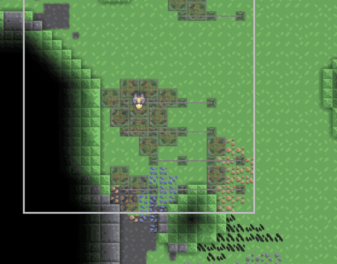
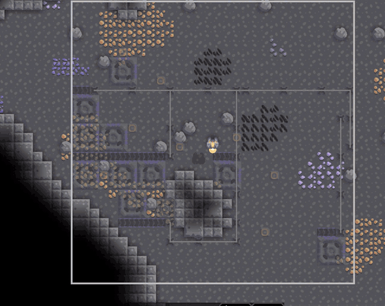
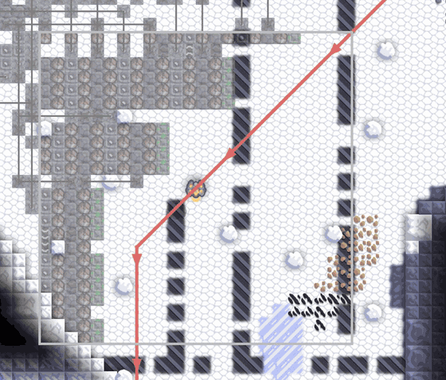

<p align="center"></p>

# AutoBuild —— Mindustry 算法自动建造

[English](README.md) | **简体中文**

在地图上框选一块区域，告诉它要建什么、输入输出在哪里，AutoBuild 会规划出整套设施，以蓝图形式预览，确认后由你的单位建造。

- **采矿场**：当前的主要功能，已经稳定。
- **防御工事**：测试功能，可以使用且有测试，但仍可能有不完善之处。

适用于 Mindustry **v8（build 160.7 及以上）**，Serpulo 星球。Java 模组，只需装在客户端（服务器不需要另装插件）。界面支持中文和英文，跟随游戏的语言设置。

> 本项目由 **Claude Opus 5.5**（Anthropic）在 Claude Code 中以中等推理强度（medium）开发：设计、算法、代码、测试和文档均由它完成，作者负责方向和实机测试。

<p align="center"></p>

---

## 目录

- [功能](#功能)
  - [采矿场（主要功能）](#采矿场主要功能)
  - [防御工事（测试功能）](#防御工事测试功能)
  - [操作界面](#操作界面)
- [核心算法](#核心算法)
- [如何测试](#如何测试)
- [安装与使用](#安装与使用)
- [构建与开发](#构建与开发)
- [参与开发](#参与开发)
- [许可证](#许可证)

---

## 功能

### 采矿场（主要功能）

**开采**
- 可用你已解锁的所有矿机；挖不动所选矿物的矿机会自动禁用。
- **大小矿机混用**：主矿机放不下的空隙，用更小的矿机（等级不超过所选矿机）填补，例如钻井 + 激光钻 + 气动钻。
- **两种目标**：
  - 最大产出：尽可能多地采矿。
  - 最大效率：只放矿格占一半以上的矿机，并偏好短的运输线路；产出仍能达到最大产出模式的 83–91%。
- **水增压**：自动规划供水行，或给每台矿机单独接水（导管、液体路由器、桥接导管）；用水不划算时会改用不浇水的布局，并在摘要里说明。
- **电力**：给耗电矿机布置电力节点，并保证连成一个电网。
- 判断矿机实际开采哪种矿时，遵循游戏的规则（沙子优先级低，数量相同时取物品编号大的）。

**运输**
- 使用传送带和物品桥。
  - 桥可以跨过墙、传送带和矿机。
  - 物品桥和桥接导管可以交替排在同一条线上。
- **线路运力**：每条输出线最多只装一条传送带的量。
  - 装不下的矿会被放弃，而不是让线路堵塞。
  - 摘要会提示：再加输出口还能多运多少。
- **输出口 / 进水口**：
  - **在边界上**：传送带从这里离开区域。
  - **在区域内**：物品送进该格。
  - **在你已有的建筑上**：物品可以送入传送带、路由器、桥、核心、金库、容器；水可以取自储液罐、导管、水泵。
  - **在地图上任意位置**：会沿空地规划一条线连过去，能绕过岩石、穿过曲折的走廊，必要时架桥。线路离开矿场的出口按实际路程选择，而不是按方向。
- **大型存储多线接入**：核心、金库、容器会按负载接入所需数量的线（最多 4 条），每条一条传送带的运力，分别从不同侧面进入。

**尊重已有设施**
- 不会建在已有设施上。
- 不会把物品混进你已有的传送线：会避开会往新线路里推物品的方块，也不会占用传送带的正前方。
- 给其他矿留出位置：传送带、桥和节点会避开其他有价值的矿格。

<p align="center"></p>
<p align="center"><sub>激光钻配气动钻填空，带水增压和电力节点；两个输出口分别在区域两侧。</sub></p>

### 防御工事（测试功能）

- **敌人路线**：按游戏寻路器的规则计算每个出生点的地面路线，框选区域时就画在地图上；空中单位画成直线。
- **路线不会改变**：路线上和路线附近不放任何东西，所以敌人仍走原来的路。规划器会用全部规划好的建筑重新验证这一点；实测中游戏自己算出的路线与预测逐格一致。
- **只用路线一侧**：所有建筑（包括墙）都放在路线空地较多的那一侧。
- **面向路线成排布置**，像手工建造的防线：
  - 墙；
  - 修理器，中间留出电力节点的位置；
  - 近程炮台；
  - 补给道；
  - 远程炮台；
  - 再一条补给道，依此类推。
- **斜向路线**：把区域分成沿路线阶梯状推进的条带，布局随路线走。
- **支持所有 Serpulo 炮台**：物品炮台、电力炮台、液体炮台、激光炮台。
  - 可同时使用多种弹药，每种由各自的传送带送入。
  - 支持液体弹药和冷却液；挨着液体补给道的炮台会被冷却。
  - 墙可选材质，厚度 1 或 2。
  - 可选修理器、修理投影器、力墙投影器，以及在路线上铺电击地雷。
- **补给道**：一排传送带或导管。
  - 挨着炮台的格子换成路由器，连续不超过 3 个，避免物品来回打转。
  - 弹药道和液体道交替排列，每排炮台都能同时得到两者。
- **主干线路**：从每个输入口连到补给道的端头。输入口可以在地图任意位置：普通格子、你的核心（会自动加装卸器）、容器、传送带、储液罐、电力节点。
  - 主干会避开敌人的射程。
  - 不会落在墙线上。
- **波次分析**：读取接下来 20 波敌人，按血量算出地面和空中的比例，以及敌人的大致射程，用来调整规划的侧重。

<p align="center"></p>
<p align="center"><sub>沿斜向路线（红色）布置：墙、修理器、成排的冰雹和蓝瑟、弹药道和水道、电力。</sub></p>

<p align="center"></p>

### 操作界面

1. 按 **F7** 或点击 **自动建造** 按钮。
2. 拖动鼠标框选区域。
3. 在设置窗口中选择标签页（**采矿场** / **防御工事**）和各项选项。
4. **点击端口位置**：
   - 可以点边界、区域内，或地图上任意位置（会规划连线）；
   - 也可以点你已有的合适建筑；
   - 右键交给规划器自动选择。
5. 规划在后台进行，搜索过程会**以灰色虚影回放**，之后以蓝图形式预览；被挡住的位置显示为红色。
6. 预览时可以：
   - **换个方案**：用不同的偏好重新搜索，并用 ◀ ▶ 在方案之间切换；
   - **添加物品输出**：增加输出线；
   - **端口**、**编辑**、**建造**。
7. 摘要会显示预计产量和每条线的负载、用水和用电量、建造成本是否超出核心库存，以及各种提醒。

---

## 核心算法

规划器是不依赖游戏的纯 Java 代码（`src/autobuild/plan`），可以离线测试。游戏侧负责读取区域快照，在后台线程运行规划器，再把结果转换成建造计划。

### 采矿场 —— `DrillLayoutPlanner`

几种**布局方式**各自走完整个流程（布局 → 布线 → 补空位 → 供水 → 供电），按**最终得分**取最好的一个。得分 = 矿的价值 − 材料 − 被占用的其他矿 − 超出运力的部分。

| 布局方式 | 方法 |
|---|---|
| **传送带矿道** | 按行做**动态规划**，决定矿道放在哪些行、哪一侧放矿机；沿每条矿道再用**一维 DP** 排布不同尺寸的矿机。矿机相距较远、或超出运力时把矿道拆开。 |
| **桥网格** | 一行行物品桥链，矿机排在周围。先用**随机化贪心**构造，再用**大邻域搜索**（局部拆除后重建）改进。 |
| **供水行** | 按行做 DP，供水行与矿道交替，矿机按增压后的产量计价。 |
| **矿机优先** | 反复选出“价值 − 连接代价”最高的矿机。用一次**多起点 A\***，从所有候选矿机的邻格同时出发，起点代价按各自价值偏移；已经挨着线路的矿机直接接入。 |

- **布线**：在“格子、方向、是否刚从桥落下”状态上做 **A\***。
  - 走法有两种：传送带走一格，或架桥跨过任何东西。
  - 代价按占用的格子数计算；在已有桥连线下方的格子，对另一种桥很便宜，可以共用走廊。
  - 编码了游戏规则：
    - 传送带不从正前方接收物品；
    - 桥不从连接方向接收物品；
    - 桥尾不向来向输出。
  - 只有**运力**允许时，新线路才能汇入已有线路；路线自相交时，去掉相交的格子重新搜索。
- **供水**：多目标**液体 A\***，可以用桥接导管，也可以从导管中间分支（该格改为液体路由器）。
- **补空位**：只要挨着还有余量的线路，就补上任意允许尺寸的小矿机；供水网络建成后再补一次。
- **供电**：先用**贪心集合覆盖**放节点，再在节点位置上做 **Dijkstra**，补中继节点直到连成一个电网（公共模块 `PowerNetwork`）。
- **区域外的端口**：
  - 从目标出发算一张**路程代价场**（带桥跳的 Dijkstra），据此选出区域边上的出口；
  - 再在整张地图上用 A\* 布线。距离估计按含桥时每格最低代价缩放，不会高估，所以线路仍是最优的。

### 防御工事 —— `DefensePlanner`、`EnemyRoutes`、`GridRouter`

- **敌人路线**：从敌人要去的核心出发计算**流场**（Dijkstra）。
  - 每格代价使用游戏的地面代价：`1 + 5×血量项 + 靠近实心方块 + 地形`。
  - 单位每步走向 8 邻格中权值最小的一格，和游戏的规则相同，由此得到每个出生点的路线。
  - 放一个实心方块 = 该格加上它的血量代价，原本不靠近实心方块的邻格各 +2，所以任何规划都可以重算路线。
- **为什么路线不会变**：规划的实心方块不碰路线格及其邻格。
  - 因此原路线的代价不变，其他路径只会更贵，最短路径仍是原来那条。
  - 规划器最后仍会重算一次来验证。
- **布局**：
  - 通道把区域分成两侧，取空地多的一侧。
  - 用到路线距离的**最小二乘拟合**，确定哪条边是“前沿”。
  - 把墙线深度变化不超过 3 格的列归成一个**条带**。
  - 每个条带按**模板**排行；尝试多种炮台顺序（近程在前、循环、单一型号、两两组合），每种都完整建出来再打分。
  - 炮台的价值是它对射程内路线格的伤害，带**边际递减**：`F(D) = K·ln(1 + D/K)`。这样火力会分散到整段路线，并兼顾地面和空中。
- **补给**：`GridRouter` 是物品和液体网络通用的 A\*。
  - 路由器、桥尾、装卸器会向所有邻格推送物品，所以它们从不挨着其他网络。
  - 主干在敌人射程内代价递增。
  - 每条补给道端头外侧那一格，对其他主干代价很高，避免把别的补给道堵死。

---

## 如何测试

- **离线测试**（`./test.sh`，不需要游戏）：
  - **采矿**：每次运行数百张随机矿区。检查：
    - 物品和液体流动模型复现了游戏的推送规则；
    - 每台矿机都能连到输出口；
    - 没有重叠、没有漏液，电网连通。
  - **防御**：120 张随机地图。检查：
    - 通道内和另一侧没有建筑，墙线前方没有补给线；
    - 每座炮台都有补给，不同网络不混流，电网连通；
    - 敌人路线不变。
- **专用服务器实测**（`./servertest.sh`、`./servertest-def.sh`）：在真实游戏中直接放下规划，然后测量。部分结果：

  | 场景 | 实测 | 预测 |
  |---|---|---|
  | 矿场 → 远处金库，3 条线 | 12.5 物品/秒 | 12.53 |
  | 远处储液罐供水 → 远处金库 | 17.65 物品/秒 | 17.78 |
  | Maze 地图，约 250 格长的线，穿过两条走廊 | 0.37 物品/秒 | 0.36 |
  | 防御：建好后的敌人路线（2 个出生点） | 270/270、266/266 格完全一致 | — |
  | Fork 地图防御实战，6 波 | 到达核心的敌人 0 个（不建防御时 16 个） | — |

- **客户端自测**（`./selftest.sh <地图>[:defense]`）：走一遍真实的界面流程。
  - 包括选端口、灰色回放、预览、换个方案、建造。
  - 会截图，也测试中文界面。

每个功能的完整开发过程（目标、算法、试错经过、验证）记录在 [DEVLOG.md](DEVLOG.md)，各版本的改动记录在 [CHANGELOG.md](CHANGELOG.md)。

---

## 安装与使用

1. 从 Releases 下载 `mindustry-autobuildDesktop.jar`，或自行构建（见下文）。
2. 放进 Mindustry 的 mods 文件夹（Windows：`%AppData%/Mindustry/mods`），或在游戏里使用 *模组 → 导入*。
3. 进入游戏，按 **F7**（或点 **自动建造**），框选区域，按设置窗口的提示操作。

要求：Mindustry v8（build 160.7 或更新），Serpulo 内容。不支持 Erekir。

---

## 构建与开发

需要 JDK 17。

```bash
./gradlew jar          # 生成 build/libs/mindustry-autobuildDesktop.jar
./test.sh              # 离线规划器测试（采矿 + 防御）
./selftest.sh Fortress # 客户端自测（需要图形环境，以及 ~/mindustry-test 下的 Mindustry.jar）
./servertest.sh <地图> <物品> <矿机> <输出> <模式> [选项]   # 专用服务器实测
```

代码结构：

| 路径 | 内容 |
|---|---|
| `src/autobuild/plan/` | 纯算法规划器：`DrillLayoutPlanner`、`DefensePlanner`、`EnemyRoutes`、`GridRouter`、`PowerNetwork` |
| `src/autobuild/` | 游戏侧：`BuildJob`（通用任务框架）、`DrillFieldJob`、`DefenseJob`、`RemotePorts`、界面（`AutoBuildMod`）、测试（`ServerTest`、`ClientSelfTest`） |
| `assets/bundles/` | 中英文文本 |
| `test/autobuild/` | 离线测试 |

---

## 参与开发

欢迎使用，也欢迎一起开发：提 issue、提想法、附截图报 bug、提 pull request 都可以。可以从这些方向入手：

- 把采矿规划器的布线迁移到通用的 `GridRouter`；
- 让玩家自己决定多个输出口之间如何分配产量；
- 防御：海上路线、主动用墙引导敌人改道（迷宫式）、点防御炮（Segment）；
- 更多语言：添加 `assets/bundles/bundle_<语言>.properties`。

提交 pull request 前请先运行 `./test.sh`，并说明你是如何在游戏里验证改动的。

---

## 许可证

[PolyForm Noncommercial License 1.0.0](LICENSE)，版权所有 © 2026 Maiolao。

你可以出于**任何非商业目的**使用、修改和分享本模组，例如游玩、学习、研究、非营利用途。**禁止商业使用**。复制或分发时请保留许可证和版权声明。

由于禁止商业使用，这是一个“源码公开”的许可证，而不是 OSI 定义的“开源”许可证。Mindustry 本身版权归 Anuken 所有，另行授权（GPL-3.0）；本模组不包含 Mindustry 的代码。
